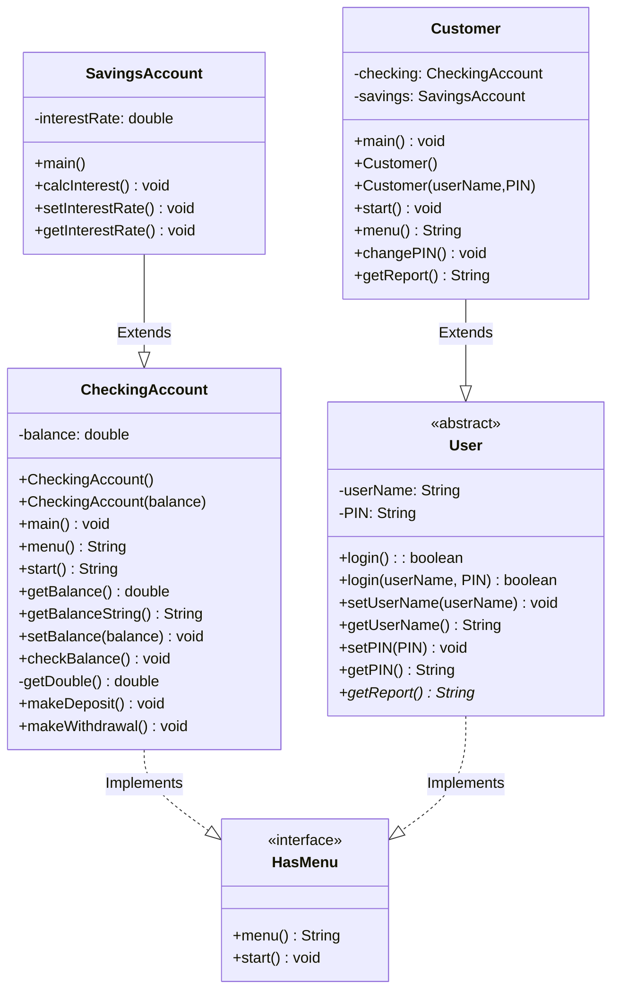

# CS121P10

## UML



### Algorithm
#### public void CheckingAccount.getBalanceString()
```
return String.format("$" + "%.02f)
```
#### private double CheckingAccount.getDouble();
```
create scanner object
try{
    double value = scanner.nextDouble()
    return value
} catch{
    print(invalid amount)
}
return 0

```
#### public void CheckingAccount.makeWithdrawal(), makeDeposit();
same functionality, just flipped signs
```
double amount = getDouble()
balance = balance +/- amount
print(new balance)
```
#### public void SavingsAccount.calcInterest();
```
setBalance(balance + interest*balance)
```

